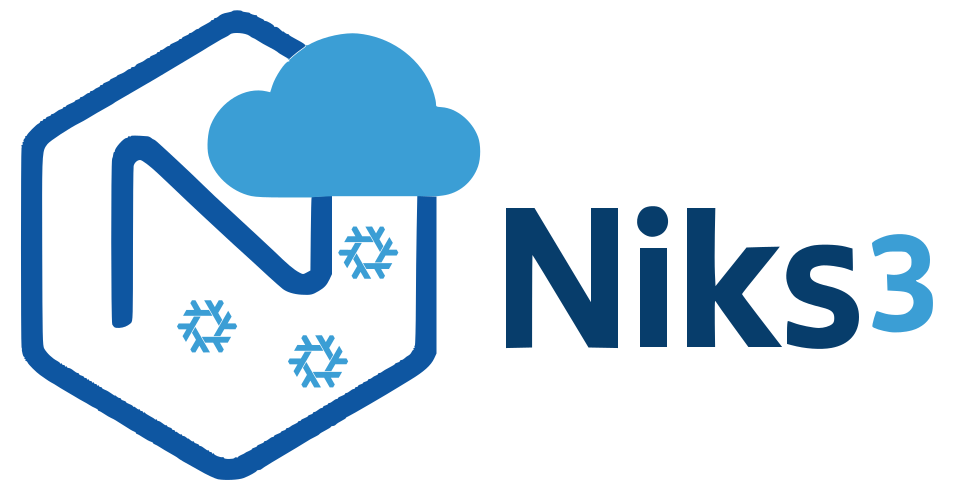
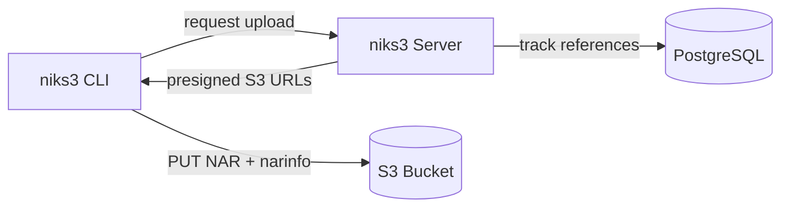
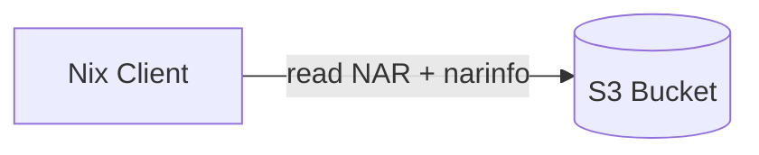
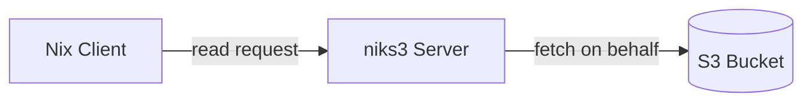

<p align="center">
  
</p>

# S3-backed Nix binary cache with garbage collection

The idea is to have all reads be handled by the s3 cache (which itself can be high-available)
and have a gc server that tracks all uploads to the cache and runs periodic garbage collection on s3 cache.
Since writes to a binary cache are often not as critical as reads,
we can vastly simplify the operational complexity of the GC server, i.e. only
running one instance next to the CI infrastructure.

## Architecture

### Write path



The niks3 CLI requests an upload from the server, which returns pre-signed S3 URLs.
The client uploads NAR files and narinfo directly to S3.
The server tracks references in PostgreSQL for garbage collection.

### Read path



Nix clients read directly from S3 (or a CDN in front of it) without going through niks3.
This allows the read path to scale independently and remain highly available.

### Read proxy (optional)



For private S3 buckets, niks3 can proxy read requests
from Nix clients to S3 using its own credentials. Enable with `--enable-read-proxy`.
See the [Private S3 Buckets](https://github.com/Mic92/niks3/wiki/Private-S3-Buckets) wiki page.

With `--read-redirect-ttl 15m` NAR requests are answered with a 307 to a
presigned S3 URL instead of being streamed, so NAR bytes bypass niks3. Narinfos
and other metadata stay proxied. Note that anyone holding such a URL can fetch
that object until it expires, regardless of read-proxy authentication.

#### Pin-scoped reads (optional)

With mTLS client certificates, niks3 can restrict read access to pin-scoped sets of objects.
A machine presents its mTLS certificate and reads only the closure reachable from its assigned pin (or pins).

Configure with module option `services.niks3.nginx.mtls.readPins`:

```nix
services.niks3.nginx.mtls = {
  enable = true;
  clientCAFile = "/path/to/ca.pem";
  boundSubjects = [ "CN=ci" ];  # full access; a cert that matches this is never pin-scoped
  readPins = [ "CN=*=host-{cn}" ]; # glob pattern mapping cert subject to pin name
};
services.niks3.readProxy.pinReadGrace = "1h";
```

**Flag syntax** for `--mtls-read-pin`:
Each entry is a rule `<subject-glob>=<pin-pattern>`.
The rule splits at the last `=`.
The subject glob matches the subject DN of the cert.
In the pin pattern, `{cn}` becomes the common name of the cert.
The result is a glob over pin names.
Example: `CN=web-*=host-{cn}` matches any cert with subject starting with `CN=web-` and maps it to pin `host-<its-cn>`.
A cert that matches `boundSubjects` or `boundSubjectsRead` is not pin-scoped.

**Grace period** (default 1 hour):
After a pin is updated (moved to a different target), the machine can still read
the previous target for this grace period.
This allows in-progress pulls to complete and rollbacks to work without interruption.
Configure with `services.niks3.readProxy.pinReadGrace` or flag `--pin-read-grace`.

**Certificate and token behavior**:
A cert that matches a pin-scoped read rule is pin-scoped.
A bearer or OIDC token sent on the same connection is ignored.
Use a narrower subject glob than `CN=*` if token writers also present certs.

**Flags and environment variables**:
`--mtls-read-pin` is repeatable. `--pin-read-grace` also reads `NIKS3_PIN_READ_GRACE`.

**Server startup validation**:
The server refuses to start when `--mtls-read-pin` is set and `--mtls-bound-subject` is empty.

**Pin name validation**:
A cert whose CN is not a valid pin name (`^[a-zA-Z0-9._-]+$`) is never pin-scoped.

**Cost**:
niks3 keeps a `pin_objects` row per object in each pin closure and fills it on each pin write,
also when no rule is set (so that rules can be enabled later without re-pinning).
The first start after the upgrade backfills all existing pins inside the migration.

**Responses**:
A pin-scoped client gets:

- 200 OK for objects in its pin's closure, and for `pins/<its-pin-name>`
- 200 OK for `nix-cache-info`
- 404 Not Found for everything else (does not disclose which objects exist)
- 403 Forbidden on write operations (`/api/*`)

Pin-scoped clients must use the read proxy, not the S3 bucket directly.

## Features

### Binary Cache Protocol Support

niks3 implements the [Nix binary cache specification](https://nixos.org/manual/nix/stable/command-ref/new-cli/nix3-help-stores.html#s3-binary-cache-store) with the following features:

- **Cryptographic signing**: NAR signatures using Ed25519 keys (compatible with `nix key generate-secret`)
- **NAR files** (`nar/`): Compressed with zstd, stored in S3
- **Narinfo files** (`.narinfo`): Metadata with cryptographic signatures
  - StorePath, URL, Compression, NarHash, NarSize
  - References, Deriver
  - Signatures (Sig fields)
  - CA field for content-addressed derivations
- **Build logs** (`log/`): Compressed build output storage
- **Realisation files** (`realisations/*.doi`): For content-addressed derivations
- **Cache info** (`nix-cache-info`): Automatic generation with WantMassQuery, Priority

### Advanced Features

- **Multipart uploads**: Efficient handling of large NARs (>100MB)
- **Transactional uploads**: Atomic closure uploads with rollback on failure
- **Garbage collection**: Reference-tracking GC with configurable retention
- **Parallel uploads**: Client parallelizes NAR and metadata uploads
- **[Streaming push](https://github.com/Mic92/niks3/wiki/Streaming-Push)**: `niks3 push --stdin` for long-running producers

### Operational Features

- Authentication via API tokens (Bearer auth)
- OIDC authentication for CI/CD systems (GitHub Actions, GitLab CI)
- S3 credentials via static keys (`--s3-access-key` / `--s3-secret-key`) or IAM (`--s3-use-iam` for IRSA, EC2 instance profiles, ECS task roles)
- [Automatic upload](https://github.com/Mic92/niks3/wiki/Auto-Upload) via post-build-hook with crash-safe SQLite queue

## Choosing an S3 Provider

niks3 works with any S3-compatible storage provider. We recommend **Cloudflare R2** for most users due to zero egress fees and excellent performance.

For detailed pricing comparison and alternative providers, see the [S3 Provider Comparison](https://github.com/Mic92/niks3/wiki/S3-Provider-Comparison) wiki page.

## Setup

For complete setup instructions, see the [Setup Guide](https://github.com/Mic92/niks3/wiki/Setup-Guide) in the wiki.

## Kubernetes

Chart: `oci://ghcr.io/mic92/charts/niks3` (source in [`deploy/helm/niks3`](deploy/helm/niks3)), image: `ghcr.io/mic92/niks3`.
See the [Kubernetes](https://github.com/Mic92/niks3/wiki/Kubernetes) wiki page
for Postgres/S3 wiring and letting pods push via their service account token.

## Monitoring

Prometheus metrics on `/metrics` and a Grafana dashboard
(`deploy/helm/niks3/files/niks3.json`, flake output `dashboards.niks3`). See the
[Monitoring](https://github.com/Mic92/niks3/wiki/Monitoring) wiki page.

## OIDC Authentication (CI/CD)

niks3 supports OIDC authentication for CI/CD systems. See the wiki for details:

- [OIDC Configuration](https://github.com/Mic92/niks3/wiki/OIDC)
- [GitHub Actions](https://github.com/Mic92/niks3/wiki/GitHub-Actions)
- [GitLab CI](https://github.com/Mic92/niks3/wiki/GitLab-CI)

## Development

For development setup, database migrations, benchmarks, and contribution guidelines, see [CONTRIBUTING.md](CONTRIBUTING.md).

## Real-World Deployments

- **Clan infra**:
  [Configuration](https://git.clan.lol/clan/clan-infra/src/branch/main/modules/web01/niks3.nix)
  | [Instance](https://cache.clan.lol/)
- **Numtide**: [Instance](https://cache.numtide.com/)
- **TUM-DSE**:
  [Configuration](https://github.com/TUM-DSE/doctor-cluster-config)
  | [Instance](https://cache.dos.cit.tum.de/)

## Need commercial support or customization?

For commercial support, please contact [Mic92](https://github.com/Mic92/) at
joerg@thalheim.io or reach out to [Numtide](https://numtide.com/contact/).
